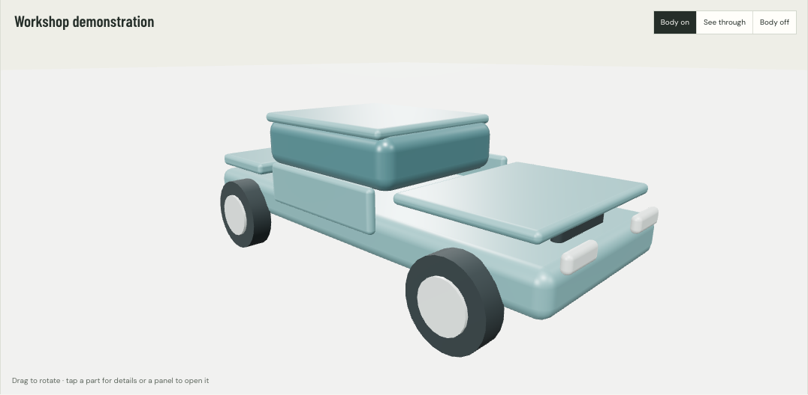
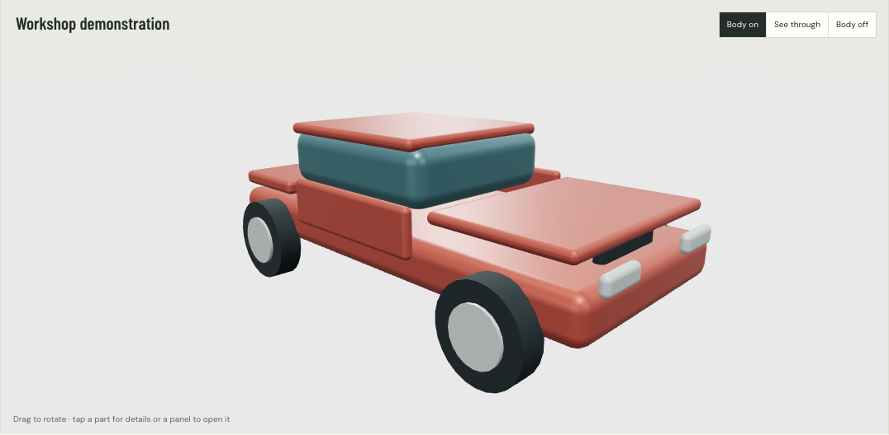
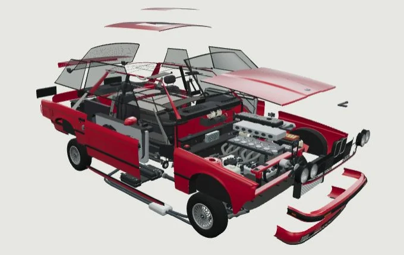
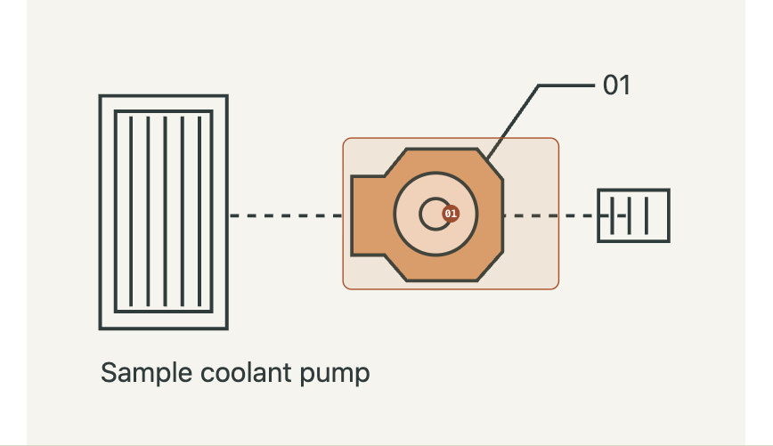

# E34 Lore & E30 Lore

Interactive BMW workshop models, parts diagrams, and repair references for the E34 5 Series and E30 3 Series.

[Live E34 site](https://e34lore.com/) · [Live E30 site](https://e34lore.com/e30)

## Workshop and catalog

Open panels, separate assemblies, and select a part to find its catalog and service references. The screenshots show the simplified models and original drawings included in the local demo.

| E34 demo | E30 demo |
| --- | --- |
|  |  |
| **Exploded view** | **Catalog drawing** |
|  |  |

The live [E34 catalog](https://e34lore.com/parts/catalog) and [E30 catalog](https://e34lore.com/e30/parts/catalog) provide BMW part numbers, numbered drawings and source fitment notes.

## In the garage

- **Identify a part.** Compare photos in the [Part Scanner](https://e34lore.com/scanner), then check the BMW number and fitment in the [E34 catalog](https://e34lore.com/parts/catalog) or [E30 catalog](https://e34lore.com/e30/parts/catalog).
- **Plan a repair.** Look up fluids, fuses, and service points in [Quick Reference](https://e34lore.com/quick-reference), or follow the [repair walkthroughs](https://e34lore.com/repairs) and [wiring references](https://e34lore.com/electrical).
- **Keep a record.** [My Garage](https://e34lore.com/garage) holds vehicles, maintenance records, builds, and private photos for both series. [Install the browser app](https://e34lore.com/app) for home-screen access.

## Contributing

[Open an issue](https://github.com/RRG314/e34lore/issues/new/choose) to report a fitment error, suggest a model detail, or share a repair source. For code and documentation changes, fork the repository and open a pull request. The [contribution guide](CONTRIBUTING.md) covers sources and model files. Use [private support](SECURITY.md) for security reports.

## Development

Use Node.js 22.13 or later and Python 3.12 or later.

```sh
npm run install:ci
npm run dev -- --host 127.0.0.1
```

Open [E34 Workshop](http://127.0.0.1:5173/workshop) or [E30 Workshop](http://127.0.0.1:5173/e30/workshop). The demo runs without credentials or a database. Pick **Sample coolant pump** in either Workshop to open its drawing and catalog entry. You can also search for `99000034001` in the E34 catalog or `99000030001` in the E30 catalog and Part Scanner. These numbers and the demo models are examples. Account, Garage and community writes require a local Supabase stack.

```sh
npm run check
npm start -- --port 3012
```

The check runs TypeScript, unit and import tests, and builds the demo. Start serves the result at [localhost:3012](http://127.0.0.1:3012). The build prepares the scanner’s browser runtime.

For database changes, run `npm run test:security:db` and `npm run test:affiliates:db` with PostgreSQL 17 server tools on PATH. The scripts start disposable databases with synthetic users and records. See [local development and releases](docs/local-development-and-release.md) for local service configuration and verification with a supplied asset pack.

## Source

| Area | Location |
| --- | --- |
| Routes, UI, and shared vehicle context | [app](app), [src/components](src/components), [src/series](src/series) |
| Three.js Workshop and model generation | [src/digital-twin](src/digital-twin), [tools/geometry](tools/geometry), [tools/generations](tools/generations) |
| Scanner and on-device processing | [src/scanner](src/scanner), [tools/scanner](tools/scanner) |
| Catalog, fitment, and service references | [src/data](src/data), [src/domain](src/domain), [src/repair](src/repair) |
| Database schema, migrations, and Edge Functions | [database](database), [supabase](supabase) |
| Build, hosting, and tests | [scripts](scripts), [worker](worker), [tests](tests) |

See [Documentation](docs/README.md) for architecture, reference data, and release procedures.

## License

Original application code uses the [Apache License 2.0](LICENSE). The [NOTICE](NOTICE) and [third-party notices](public/THIRD-PARTY-NOTICES.txt) cover assets and software with their own terms.

## Credits

See the [site source library](https://e34lore.com/resources) for vehicle and service references. The demonstration models and drawings are original [CC0](https://creativecommons.org/publicdomain/zero/1.0/) assets.

E34 Lore is an independent enthusiast project.
