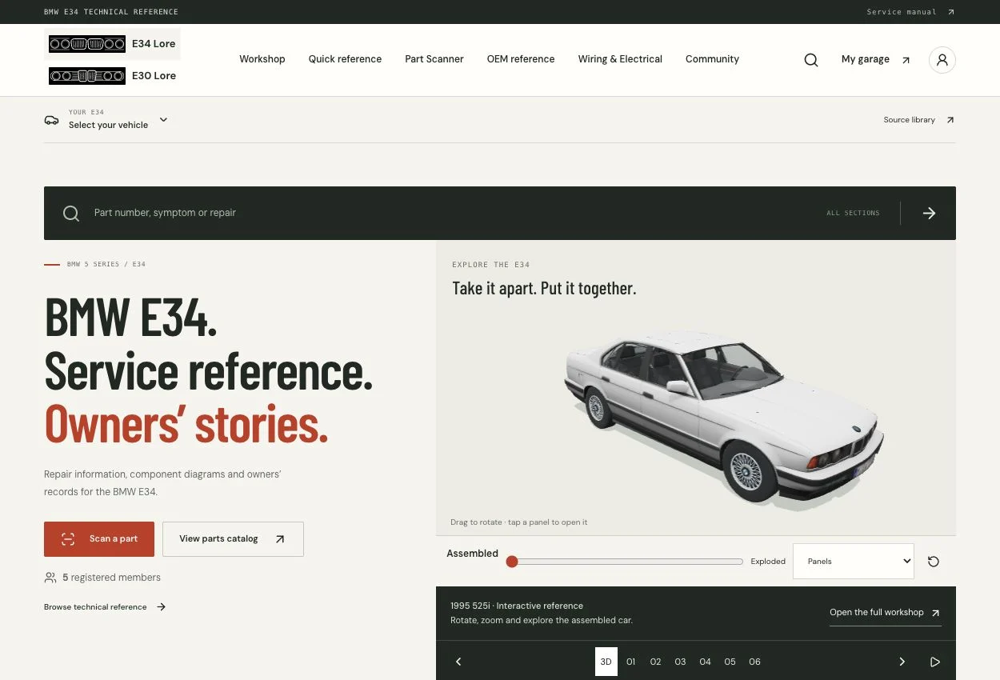
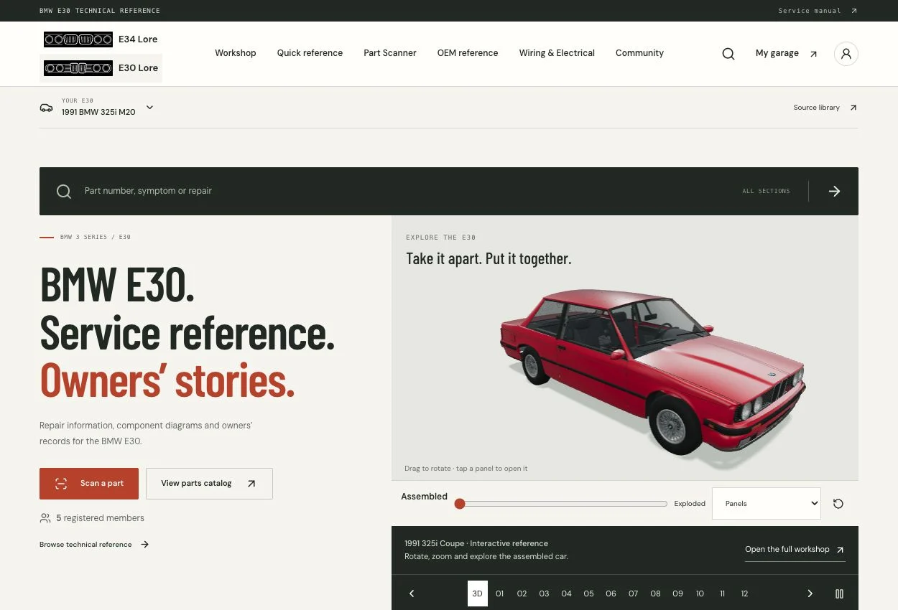
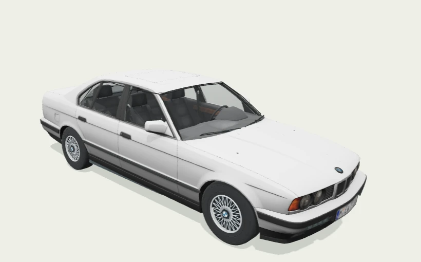
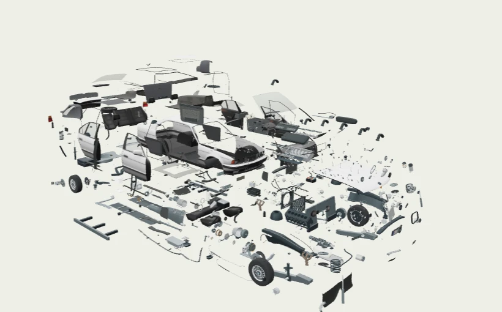
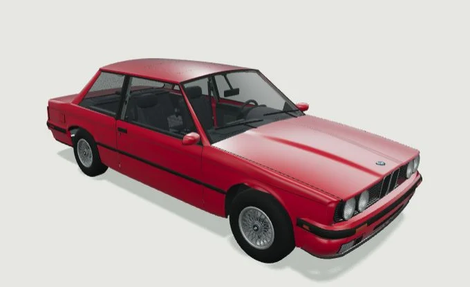
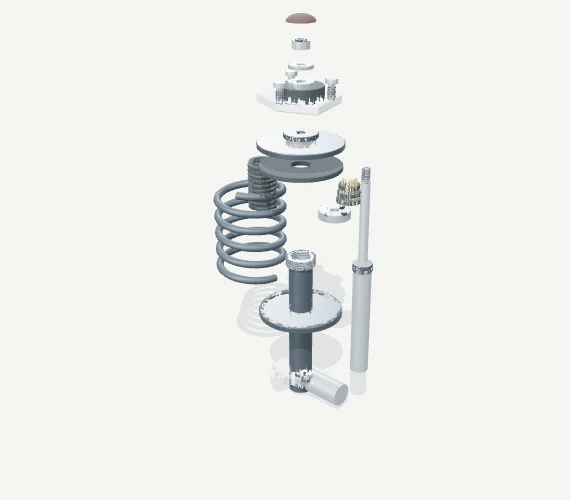
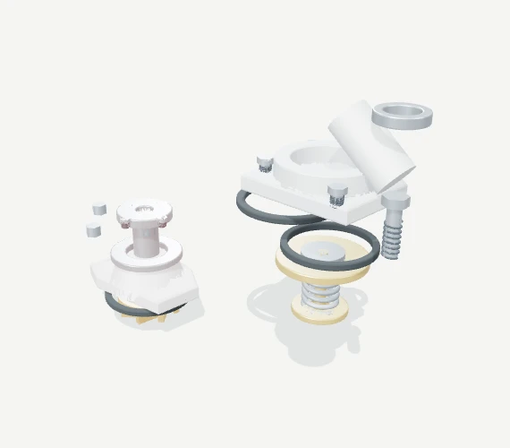

# E34 Lore & E30 Lore

Interactive BMW workshop models, parts diagrams, and repair references for the E34 5 Series and E30 3 Series.

| [E34 Lore](https://e34lore.com/) | [E30 Lore](https://e34lore.com/e30) |
| --- | --- |
| [](https://e34lore.com/) | [](https://e34lore.com/e30) |

## The Workshop

Open the hood or doors, separate assemblies, and select a component to find its catalog and service information. Select either image to open that car in the Workshop.

| Assembled | Exploded |
| --- | --- |
| [](https://e34lore.com/workshop) | [](https://e34lore.com/workshop) |
| **1995 525i sedan · automatic** | **E34** |
| [](https://e34lore.com/e30/workshop) | [](https://e34lore.com/e30/workshop) |
| **1991 325i coupe · M20, manual** | **E30** |

## Parts and diagrams

| [Front strut assembly](https://e34lore.com/parts?assembly=front-strut) | [Water pump and thermostat](https://e34lore.com/parts?assembly=water-pump) |
| --- | --- |
| [](https://e34lore.com/parts?assembly=front-strut) | [](https://e34lore.com/parts?assembly=water-pump) |

Find numbered drawings, BMW part numbers, and fitment notes in the [E34 catalog](https://e34lore.com/parts/catalog) and [E30 catalog](https://e34lore.com/e30/parts/catalog).

## In the garage

- **Identify a part.** Compare photos in the [Part Scanner](https://e34lore.com/scanner), then check the BMW number and fitment in the [E34 catalog](https://e34lore.com/parts/catalog) or [E30 catalog](https://e34lore.com/e30/parts/catalog).
- **Plan a repair.** Look up fluids, fuses, and service points in [Quick Reference](https://e34lore.com/quick-reference), or follow the [repair walkthroughs](https://e34lore.com/repairs) and [wiring references](https://e34lore.com/electrical).
- **Keep a record.** [My Garage](https://e34lore.com/garage) holds vehicles, maintenance records, builds, and private photos for both series. [Install the browser app](https://e34lore.com/app) for home-screen access.

## Contributing

[Open an issue](https://github.com/RRG314/e34lore/issues/new/choose) to report a fitment error, suggest a model detail, or share a repair source. For code and documentation changes, fork the repository and open a pull request. The [contribution guide](CONTRIBUTING.md) covers sources and model files. Use [private support](SECURITY.md) for security reports.

## Development

Use Node.js 22.13 or later and Python 3.12 or later.

```sh
npm run install:ci
npm run dev -- --host 127.0.0.1
```

Open http://127.0.0.1:5173. The development server uses a loopback Supabase endpoint. Without a local Supabase instance, static pages and bundled reference content work. Account and Garage writes, community posts, and database-backed catalog lookups need a backend.

For a local backend, use the [Supabase CLI with Docker](https://supabase.com/docs/guides/local-development/cli/getting-started). Copy `.env.example` to `.env.local` and enter the local publishable or legacy anon key. The migration history uses the older schema under `database/` as its baseline. Use the isolated SQL test below for policy work. A complete one-command local Supabase bootstrap for Auth, Storage, Edge Functions, and imported catalog data still needs verification.

```sh
npm run typecheck
npm test
npm run test:import
E34_E30_BUILD=1 E34_LOCAL_BUILD=1 npm run build
```

To preview that build, run `npm start -- --port 3012`. Open [E34 Workshop](http://127.0.0.1:3012/workshop), [E30 Workshop](http://127.0.0.1:3012/e30/workshop), or [Part Scanner](http://127.0.0.1:3012/scanner). Pick a model, select a component and use its part information to check a catalog link. The Workshop also hosts Build Studio.

With PostgreSQL 17 server tools on your PATH, run `npm run test:security:db` and `npm run test:affiliates:db`. Each starts a disposable local database. The security suite exercises migrations, owner and staff access, media boundaries, and synthetic restore. Use these commands for database changes. The full HTTP suite needs a populated local backend. To run the route-only checks against the local preview, use `E34_TEST_ORIGIN=http://127.0.0.1:3012 node tests/release-http.mjs`. Full setup and hosted verification are maintainer tasks.

## Source

| Area | Location |
| --- | --- |
| Routes, UI, and shared vehicle context | [app](app), [src/components](src/components), [src/series](src/series) |
| Three.js Workshop and model generation | [src/digital-twin](src/digital-twin), [tools/geometry](tools/geometry), [tools/generations](tools/generations) |
| Scanner and on-device processing | [src/scanner](src/scanner), [tools/scanner](tools/scanner) |
| Catalog, fitment, and service references | [src/data](src/data), [src/domain](src/domain), [src/repair](src/repair) |
| Database schema, migrations, and Edge Functions | [database](database), [supabase](supabase) |
| Build, hosting, and tests | [scripts](scripts), [worker](worker), [tests](tests) |

See [Documentation](docs/README.md) for architecture, reference data, and release procedures.

## License

Original application code uses the [Apache License 2.0](LICENSE). The [NOTICE](NOTICE) and [third-party notices](public/THIRD-PARTY-NOTICES.txt) cover assets and software with their own terms.

## Credits

The E34 525i exterior is adapted from [BMW 525i e34 | Project Zomboid](https://sketchfab.com/3d-models/bmw-525i-e34-project-zomboid-c65aa3b7687d4f5dbbabdfad0b7816bb) under CC BY 4.0. See the [Workshop model credits](public/models/ATTRIBUTION.json) and [site sources](https://e34lore.com/resources).

E34 Lore is an independent enthusiast project.
