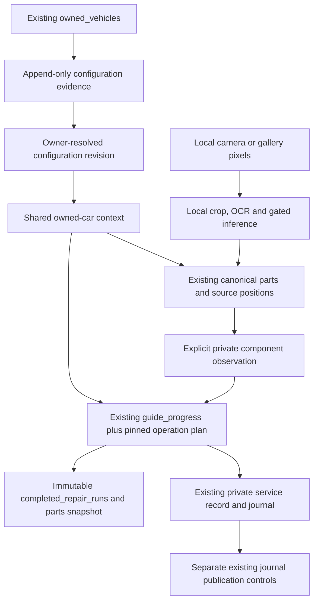

# Extending the scanner, configuration and repair system

Use the existing private repository, Supabase project and release pipeline. Installed migration `20261108072214_scanner_vehicle_repair.sql` is immutable; change hosted schemas/registries through a new additive tested migration. Do not regenerate missing geometry, labels or fitment as if they were measured facts.

## Relationships and processing boundary

`vehicle_configuration_evidence` and `vehicle_configuration_revisions` are owner/car scoped. `component_observations` may refer to a canonical part, an illustrative component and a configuration revision. `scanner_corrections` belong to their observation; private staff decisions require current admin/MFA and are audited. Trusted component/model/plan registries are public-read only. Existing progress has composite same-owner/car references to observation/configuration. `repair_parts_used` belongs to progress; completed runs retain guide/configuration/parts history. Car/account deletion cascades owner data; deleting a scan removes its corrections and unlinks its repair references. No browser service credential, image-processing server, upload bucket or separate job database is required for the implemented local path.

## Add a recognizable component or model

1. Identify the existing catalog assembly and actual r14 node(s). Preserve assembly alternatives and applicability conditions; a category, thumbnail or casting does not establish a canonical part number. Extend the authoritative asset/catalog pipeline if the node does not exist; register truthful unavailable geometry meanwhile.
2. Obtain permissioned/licensed photos with creator, license, allowed uses, attribution, viewpoint, changes, source revision and content hashes. Record actual manufacturer/OEM markings and the independent reviewer/evidence where known. Leave exact identity unverified otherwise. Keep owner cars/images private unless separately authorized.
3. Extend `docs/scanner/evaluation/source-manifest.json` and the versioned source receipts. Split different vehicles/physical parts/near-duplicates across reference, training, calibration and held-out testing; do not use a test image as a reference. Include visually similar incompatible parts and unrelated negatives. Add expert bounding boxes before claiming detection IoU/precision/recall.
4. Reproduce the local evaluation with the commands in [models/data](models-and-data.md). The committed exporter creates normalized512D reference vectors, thumbnails and credits in `public/scanner`; review source/derivative hashes and rights before committing. Keep synthetic renders explicitly marked synthetic. The current convenience sample cannot certify E34-wide recognition.
5. When changing an encoder, pin source revision, actual weight hash/bytes/license and matching preprocessing in `src/scanner/contracts.ts`, `inference.worker.ts` and evaluation scripts. Regenerate all reference vectors with that exact encoder. Add an immutable `scanner_model_versions` entry in a new migration; do not relabel an old model version. Preserve ONNX/runtime notices and the host's25MiB individual-file limit.
6. Evaluate held-out top1/top5, per-class confusion, incompatible/OOD rejection, calibrated confidence and boxes/masks where used. Record first-load as well as warm inference, peak process/browser memory, model bytes and failure cases. Fine-tuning requires sufficient expert-labelled data and a saved training configuration; none is claimed for the current model.
7. Keep `scanner_runtime_config` public visual access false until independently reviewed recognition and actual Android/iOS evidence justify a deliberate audited release change. A cosmetic public toggle does not establish accuracy. Existing current-MFA staff tests can run genuine local inference and retain unknown outcomes.

## Add a verified repair procedure

1. Locate the actual source procedure, production/equipment scope, safety, tools, fasteners, replacement items, torque and fill/bleed specifications. Visually verify source pages and write original instructions; retain the exact page and hardware qualifiers. Never carry an M50 value into another engine because the model looks similar.
2. Extend the existing guide/revision archive first. Publish a new immutable revision rather than mutate an installed plan's referenced text. The current vertical pins guide `m50-water-pump-job-planning`, revision `5c458d5b100cc7b4c5c2b469`, plan `m50-coolant-pump-r1`.
3. Follow `src/repair/plan.ts`: stable operation IDs, exact guide step, prerequisite IDs, actual model node IDs, action, source, tools and scoped torque. Run graph validation; require a complete acyclic forward/reassembly order. A missing modeled seal/belt remains absent rather than receiving a fictitious precise shape.
4. For an additional procedure, make plan selection explicit while retaining existing progress and the working M50 plan. Export/review with `scripts/build-repair-plan.mjs` (currently scoped to M50; parameterize it when adding a second plan). Register a new immutable plan and exact guide revision through an additive migration. Do not overwrite active sessions or historical runs.
5. Reuse `RepairPanel`, current `ReferenceWorkshop`/renderer and existing guide_progress/service/journal functions. Preserve two-way exact-part selection, source catalog panel, focus/isolate/zoom, owner/car scope and content-version conflict handling. Match applicability to actual installed configuration, not only the original factory model.
6. Test skipped/invalid prerequisites, undo while dependents exist, exact member of a multi-node operation, revision mismatch, configuration changes, concurrent devices, parts-used snapshots, completion→private journal/service, another run and deletion. Use isolated synthetic owners only. Verify the genuine browser/viewer and a permissioned real car before marking that flow physically verified.
7. Verified physical removal paths need actual dimensions/assembly transforms, neighboring surfaces, fastener/tool access and swept-clearance validation. Current display separation is illustrative. Record a separate reviewed geometry status only after those measurements exist; do not infer it from smooth animation.

## Add vehicle variants or factory evidence

Use `src/vehicle/configuration.ts` evidence types and explicit resolutions. Preserve factory, observed, modified, inferred and unknown records with source/date/supersedes; use revision concurrency and existing model IDs. A swapped engine changes current context without destroying factory evidence. Keep owner-specific conclusions out of universal fitment records.

NHTSA vPIC is optional, explicitly consented and limited to its real response. Manual setup works without a VIN. It does not supply complete BMW option/build records; partial-VIN decoding is not implemented here. Additional BMW-specific sources require permitted API/data access, a documented source contract and actual sample verification. Do not scrape account-gated records or buy a service without owner authorization. Do not automatically persist/publish the full VIN or provider payload.

Add only measured or honestly classified existing engine/transmission/body/equipment assets through the current geometry pipeline. Configuration selection should choose available correct assemblies and hide unavailable variants, preserving visible gaps. It must not show an M50 assembly as an M60 because a different engine was selected.

## Finish the remaining verification gates

Use the detailed protocol in [verification](verification.md) on physical Android Chrome and iOS Safari: camera allow/deny, rear capture, rotation, focus/torch/zoom where supported, background/late permission cleanup, real marking photos, difficult lighting and incompatible/OOD negatives. Measure cold/warm latency, memory, thermal behavior and camera shutdown. Desktop width checks and a gallery photo do not satisfy those rows.

With a permissioned actual owner/car in non-production first, perform scan/marking→canonical catalog→applicable pinned repair→parts/outcome→private service/journal, resume on another device and test explicit publication/withdrawal. The current live owner has no owned car; no fake one was created to claim this flow. Reuse `tests/scanner-pipeline.sql` for ownership/concurrency fixtures and then inspect actual browser persistence with the supplied real car.

Run repository checks, isolated SQL/security/restore, production build, confidentiality/asset limits and served route/security checks. Open a dedicated branch/PR, pass matching website/SQL and Android CI, apply additive dependencies before the matching web artifact, publish through existing Sites and verify custom-domain/browser behavior. Keep exact source/deployment/artifact receipts. Optional analytics remains paused pending the separate privacy approval; scanner data never grants permission to enable collection.
