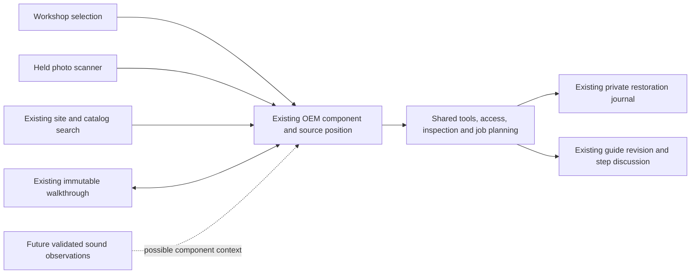

# E34 Lore organization and servicing audit

8 November 2026. Local branch `steven/workshop-selection-restore`, based on `a16bd817bb0b5442e2e22675d42a0493e4d120c1`. Production v45 is unchanged. The separate v45 cleanup worktree remains available and has not been folded into a remote release. The main local review now uses port3006 and includes the additional native vehicle references. No push, pull request, merge, migration or publication is authorized by this audit.

## Canonical component context

Keep `/parts/catalog?part=<existing canonical id>&position=<source occurrence>` as the component destination. Workshop nodes, source assemblies, selected geometry revision and garage navigation are references to that identity, rather than another component database. `src/servicing/context.ts` builds that destination and its reciprocal workshop link. Public sharing removes car and saved-identification UUIDs, while preserving public model/revision/source selection. Selecting an option still requires reading its source production and equipment conditions.

The existing workshop sidebar and catalog use `CatalogProcedures.ServiceLinks`. That now embeds the same `ServiceOverview` used by the existing walkthrough and interactive repair. No guide archive, renderer, catalog, community or garage has been replaced. Catalog navigation retains a model reference only while its source context still agrees. Exact source-position matching takes priority over an equivalent number in another selection.

Sound observations and visual identifications require separate acquisition and evaluation pipelines. They may eventually suggest the same existing component; neither similarity nor a photograph establishes a mechanical fault or verified fitment. No audio diagnosis or reference dataset has been invented or enabled.

## Route and feature inventory

These groups describe the user journey; they do not add five applications or five new menu levels.

| Existing route | Purpose and current state | Consolidation / next boundary |
| --- | --- | --- |
| `/` | Hero, retained 525i demonstration, repairs, OEM and community discovery | Keep the existing concise main navigation; no experimental scanner entry in production build |
| `/workshop` | Native 525i reader; eight additional sedan/Touring/manual/automatic references now integrated locally | Compact view tabs and one Car model selector; preserve focus, isolate, details, zoom and separation |
| `/workshop?tab=diagrams` | Existing source drawing/catalog reader with model/year/body/transmission selections | Source diagrams remain distinct from 3D geometry; carry explicit selected model/source context |
| `/workshop/repair` | Existing M50 operation graph, progress and garage completion workflow | Held in production; shared full-job servicing and validated operation deep links added locally |
| `/workshop/assets`, `/workshop/inspections` | Private source/model review | Existing staff/MFA boundaries; never public authoring controls |
| `/parts`, `/parts/catalog` | Existing canonical OEM identities, source positions, ordering conditions and drawings | Central component destination, shared service section and reciprocal model links |
| `/parts/reference` | Legacy original service figures and nominal/illustrative 3D examples | Preserve old links; identify illustration scope; keep under OEM navigation |
| `/parts/interchange` | Source replacements and reviewed direct compatibility evidence | Inside OEM reference; no separate main-menu destination or inferred transitive fitment |
| `/repairs` | Existing search across original guides and indexed manual jobs | Same guide IDs; no second procedure registry |
| `/guides/:slug` | Immutable revision-aware written walkthrough and progress | Shared tools/access/inspection replaces the duplicate flat sidebar list |
| `/manual`, `/manual/:chapter`, `/manual/EWD`, `/manual/INDEX` | 47 indexed chapters, wiring/index source hubs | An index is not a completed repair procedure or license to republish the scan |
| `/quick-reference/fluids` | Existing source-scoped fluid specifications | Keep engine/market/year limits explicit; do not infer ATF/CHF or gearbox identity |
| `/quick-reference/fuses` | Existing fuse table, relay-layout examples and source pages | Reuse for electrical entry points; no invented wire/pin connectivity |
| `/quick-reference/locations` | Existing vehicle maps and service-location references | Reuse for electrical/inspection location context; no fake measured geometry |
| `/diagnostics` | Sourced cooling triage; other branches are intake/referral | Retain existing graph; comprehensive warning/circuit testing still needs source-specific work |
| `/scanner`, `/scanner/credits` | Existing local camera/OCR and staff-only visual experiments | Entire scanner route and public calls to action held in production; canonical component handoff reused |
| `/garage/configuration` | Existing private installed-hardware evidence/revisions and VIN capture | Experimental interface held in production; ordinary car details remain available |
| `/garage` | Owned cars, details, photos, private journals, service records, modifications and bookmarks | Personal planned-job snapshots reuse private journal entries; no duplicate garage table |
| `/garages`, `/garages/:owner/:entry` | Explicit public garage/car snapshots | Preserve publication/withdrawal boundaries; no private plan or inspection auto-publication |
| `/community`, `/community/:thread` | Native threads, advice feedback, questions and source context | Keep exact part and guide revision/step links |
| `/community/new` | Existing question/editor flow including moderated guests | Reuse for uncertain identifications, inspection questions and specialist recommendations |
| `/community/cars` | Existing featured cars and projects | Uses garage publication model, not a second car database |
| `/community/topics`, `/community/issues` | Existing starter topics and recurring-problem references | Editorial references do not impersonate member posts |
| `/community/policies`, `/community/settings`, `/community/admin` | Community rules, preferences and existing privileged governance | No duplicate moderation interface |
| `/search` | Shared guide/manual/OEM/community search | Parts already lead to canonical catalog IDs; unsupported results must remain unknown |
| `/encyclopedia`, `/models/:id`, `/articles/:slug` | Existing technical overviews and source pointers | Discovery content, not competing component identity pages |
| `/resources`, `/partnerships` | Evidence, attribution/privacy and retailer/ad explanations | Keep reference and commercial claims separate |
| `/account` | Existing member identity, OAuth, username, MFA, signout/deletion | No account or role changes in this audit; workshop identity remount clears account-specific saved view state |
| `/manage` and `/manage/{scanner,analytics,security,support,partners,models}` | Existing staff/MFA dashboards and review queues | New review types must reuse the boundary; current queues are not a sound/business review implementation |
| `/admin` | Existing technical review desk | Preserve its separate permission boundary |
| `/support`, `/roadmap` | Existing support/roadmap | Email delivery remains its separately deferred setup; do not claim it was activated |
| `/app` | Existing PWA/Android install information | Same routes/data; no Play release or signing changes in this work |
| `/shop`, `/marketplace` | Existing coming-soon pages | No vehicle parts checkout or member listing marketplace is implied |

## Fragmentation found and changes made locally

1. The view-switch navigation inherited `.page`'s 55vh minimum height, producing the tall cards in the owner's screenshots. It now has an explicit zero minimum height and compact 34px desktop /40px mobile controls. The Car model selector shares that row; all choices change actual native 3D data, rather than hiding incompatible objects in the 525i.
2. The old garage comparison filtered the single M50 reference for a selected V8 car, which could remove the engine/transmission entirely. Ordinary browsing now loads an explicit reference. The existing comparison filter is retained only in the held M50 repair workflow.
3. Variant runtime export omitted registry parents/systems. The exporter now closes parent/system dependencies and validates the complete native manifest before writing it. All eight files pass schema, source hash, asset/thumbnail and catalog occurrence checks.
4. Per-node variant separation repeatedly rebuilt equivalent offset maps. Full offsets are now cached per immutable model/scope. Independent units use the liked 540i display layout and minimum spread policy; doors carry attached glass/trim in whole-car scope and their own scopes expose the children. The original 525i manifest and separation branch remain unchanged.
5. Saving one model's views previously bounded all other revisions together to20. The local store now keeps20 per revision with a bounded32-revision envelope; views cannot silently bind to another geometry revision.
6. Flat tool strings and separate guide links made component servicing incomplete. One revision-aware projection now consolidates the existing M50 operation tools, dependencies, inspection and reassembly checks. Other guides retain their source tool lists and explicitly lack indexed step assignments; no guessed socket sizes or tolerances were added.
7. Personal budgeting reuses the private journal: exact guide revision, entered costs, owned-tool exclusions, unknown amounts and the dated planning basis are saved together. It never marks a repair complete or auto-publishes an entry. Current offer prices remain in the existing approved retailer component; user-entered values are not represented as quotes.

## Mobile and desktop acceptance

The production-style local build keeps photo capture/interactive repair/experimental configuration routes absent. Model selector and view tabs must be checked at390px and desktop width. Existing Expand, focus/isolate and details stay in the native viewer. The model remains scroll/pinch zoomable. A collapsed service section avoids adding a permanent panel over the model. Owner sign-in and a deliberate journal save are still needed to establish actual hosted-account acceptance; automated checks do not create invented owner records.

See `coverage.md` and `coverage.json` for40 current guides,47 chapter indexes,9 runtime references and5,632 selectable instances. These are model instances, not a claim that every real fastener or part in every E34 has been modeled.
